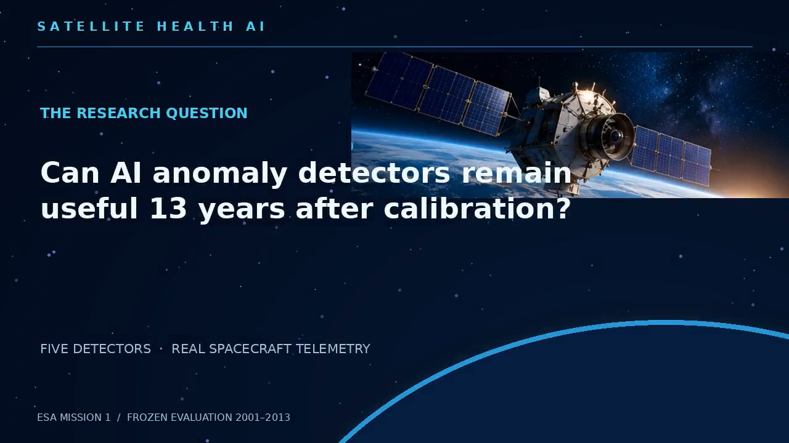
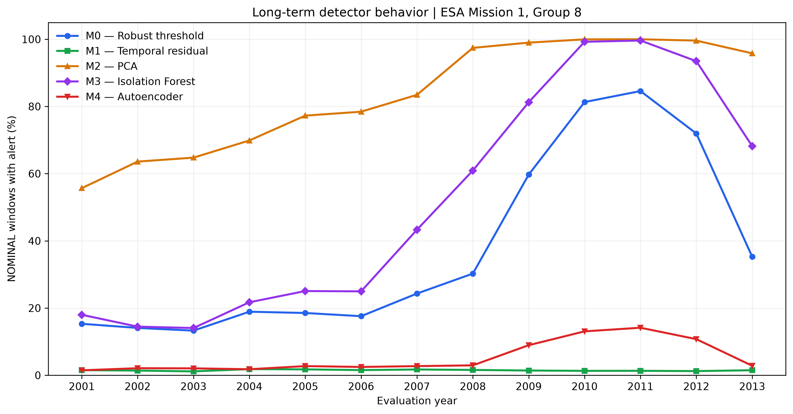
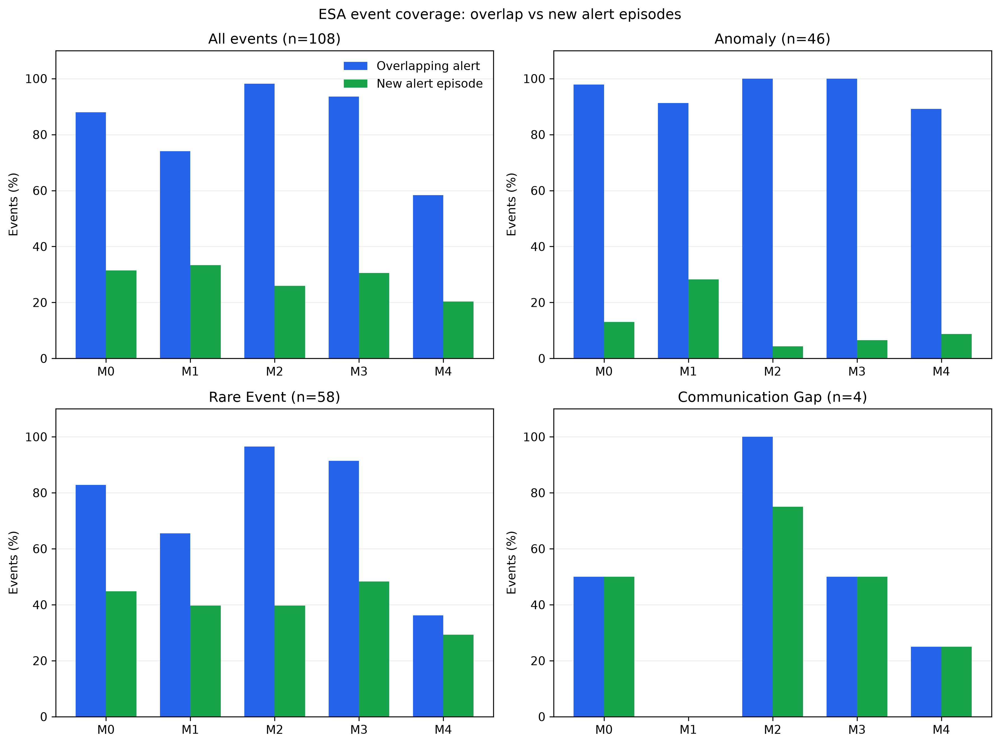
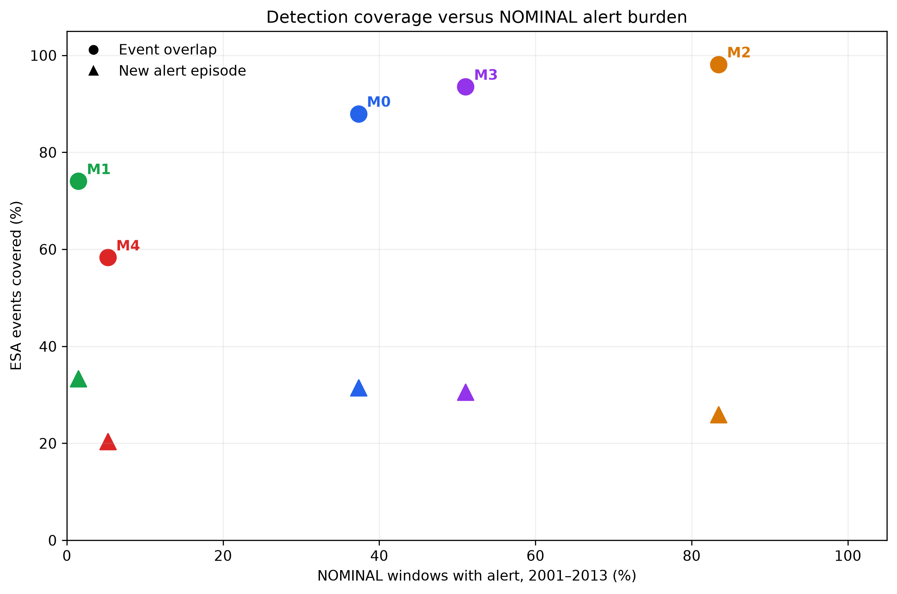

# Satellite Health AI

**Long-Term Spacecraft Telemetry Anomaly Detection | Applied AI & R&D**

An applied research project investigating whether anomaly detection models trained and calibrated on historical spacecraft telemetry remain operationally useful over **13 subsequent years without retraining or threshold recalibration**.

The study combines statistical baselines, classical machine learning and neural-network reconstruction methods, with a focus on temporal generalization, alert persistence, annotated-event coverage and operational trade-offs.

## Project video

[](docs/video/satellite_health_ai.mp4)

*Watch the 42-second research overview — ESA spacecraft telemetry, five anomaly detection models, and 13 years of frozen-model evaluation.*

**Key finding:** High annotated-event overlap does not necessarily indicate effective anomaly detection. Models that remain in an alert state for long periods may overlap nearly every event without providing a useful indication of its onset.

## Research objectives

The primary research question is:

**Can anomaly detectors calibrated using spacecraft telemetry from 2000 remain useful during 2001–2013 without retraining?**

The investigation addresses three complementary questions:

1. How do five anomaly detection methods behave under a frozen long-term evaluation protocol?
2. How does persistent alerting affect the interpretation of ESA event overlap?
3. Can the same modeling and calibration workflow be applied to a second telemetry group belonging to a different spacecraft subsystem?

## Research workflow

```text
ESA Mission 1 Telemetry + Event Annotations
                     |
                     v
        Telemetry Preparation
                     |
                     v
     Temporal Training / Calibration
       Train: Jan–May 2000
       Calibrate: Jun–Aug 2000
                     |
                     v
          Anomaly Detection
       M0 | M1 | M2 | M3 | M4
                     |
                     v
        Frozen Model Evaluation
              2001–2013
                     |
                     v
         Operational Assessment
       - Alert burden
       - ESA event overlap
       - New alert episodes
       - Temporal stability
                     |
                     v
        Scientific Interpretation
```

The main study uses Group 8. A secondary cross-group pilot evaluates workflow portability on Group 18 using M0–M3.

## Dataset and experimental protocol

| Component | Primary experiment |
|---|---|
| Data source | ESA Mission 1 spacecraft telemetry and event annotations |
| Telemetry | Group 8, channels 41–46 |
| Number of channels | 6 |
| Analysis unit | Non-overlapping 30-minute windows |
| Model training | January–May 2000, nominal windows |
| Threshold calibration | June–August 2000, nominal windows |
| Threshold selection | 99th percentile of 30-minute maximum scores |
| Evaluation | 2001–2013 |
| Evaluation windows | 227,904 |
| Annotated ESA events | 108 |

The models and thresholds remain frozen throughout the evaluation period. No 2001–2013 telemetry is used for model refitting or threshold recalibration.

The analysis uses three ESA event categories: **Anomaly (46 events), Rare Event (58 events) and Communication Gap (4 events)**.

The project is a focused historical case study, not a benchmark across ESA missions. Raw ESA telemetry and large generated artifacts are stored outside the Git repository.

## Anomaly detection models

| Model | Approach | Detection principle |
|---|---|---|
| **M0** | Robust Threshold | Per-channel deviations from nominal behavior |
| **M1** | Causal Temporal Residual | Deviations relative to preceding observations |
| **M2** | Principal Component Analysis | Multivariate reconstruction / squared prediction error |
| **M3** | Isolation Forest | Isolation-based multivariate anomaly scoring |
| **M4** | Feed-forward Autoencoder | Neural-network reconstruction error |

The Autoencoder uses a compact **6 → 4 → 2 → 4 → 6** architecture.

Model documentation: [M0](docs/models/M0_robust_threshold.md) · [M1](docs/models/M1_temporal_residual.md) · [M2](docs/models/M2_pca_multivariate.md) · [M3](docs/models/M3_isolation_forest.md) · [M4](docs/models/M4_autoencoder.md).

## Evaluation methodology

Three complementary measures characterize operational behavior:

**Nominal alert fraction:** Fraction of scorable ESA-NOMINAL evaluation windows containing an alert. This represents alert burden, not a verified false-positive rate.

**ESA event overlap:** Fraction of annotated events intersected by at least one alert, including alerts that started before the event.

**New alert episode coverage:** Fraction of annotated events during which a new alert episode begins. This distinguishes newly initiated alerts from persistent alert states, without establishing causal detection.

These measures should be interpreted jointly rather than reduced to a single performance score.

## Results I — Long-term evaluation on Group 8

| Model | Nominal alert fraction | ESA event overlap | Events with new alert episode |
|---|---:|---:|---:|
| M0 — Robust Threshold | 37.34% | 95/108 (87.96%) | 34/108 (31.48%) |
| **M1 — Temporal Residual** | **1.48%** | **80/108 (74.07%)** | **36/108 (33.33%)** |
| M2 — PCA | 83.45% | 106/108 (98.15%) | 28/108 (25.93%) |
| M3 — Isolation Forest | 51.06% | 101/108 (93.52%) | 33/108 (30.56%) |
| M4 — Autoencoder | 5.24% | 63/108 (58.33%) | 22/108 (20.37%) |

**Main observation:** M1 provides a comparatively favorable operational trade-off under the selected metrics. It maintains a low nominal alert fraction while initiating alert episodes during 36 of 108 annotated events.

M2 and M3 achieve greater event overlap, but their much higher nominal alert fractions demonstrate why overlap alone can be misleading.

### Temporal stability



*Year-by-year nominal alert burden over the frozen 2001–2013 evaluation period.*

### Annotated-event coverage



*Event overlap and newly initiated alert episodes are evaluated separately across ESA annotation categories.*

### Operational trade-off



*High event overlap can coexist with excessive alert burden. The horizontal axis is not a false-positive rate.*

## Results II — Cross-group pilot on Group 18

To investigate whether the workflow can be applied beyond the original telemetry subset, a secondary experiment was conducted on **Group 18, channels 70–76**, associated with a different spacecraft subsystem.

The pilot reuses M0–M3, with group-specific model fitting and threshold calibration. It does **not** transfer pretrained Group 8 model parameters.

Unlike Group 8, the raw Group 18 channels do not share identical timestamps. A common five-minute sampling grid is therefore used before multivariate analysis.

| Component | Group 18 pilot |
|---|---|
| Telemetry channels | 7 (70–76) |
| Models | M0, M1, M2, M3 |
| Training / calibration | Nominal windows in 2000 |
| Evaluation period | 2001–2013 |
| Evaluation windows | Approximately 226,900 |
| ESA annotated events evaluated | 24 |

### Group 18 results

| Model | Alert windows (%) | ESA events overlapped | Alert episodes |
|---|---:|---:|---:|
| M0 — Robust Threshold | 1.09% | 7/24 (29.17%) | 1,947 |
| M1 — Temporal Residual | 2.39% | 10/24 (41.67%) | 4,797 |
| **M2 — PCA** | **1.78%** | **14/24 (58.33%)** | **3,498** |
| M3 — Isolation Forest | 0.08% | 0/24 (0%) | 166 |

The pilot confirms that the workflow can be executed on a second telemetry group with different synchronization requirements.

It also reveals markedly different model behavior: M2 has the highest annotated-event overlap in Group 18, while M3 generates very few alerts and overlaps no annotated evaluation events.

**Cross-group comparison caveat:** Group 18 uses five-minute synchronization and simplified event-overlap and episode accounting. Its alert fraction is calculated across scorable evaluation windows, whereas the Group 8 table reports ESA-NOMINAL alert fraction. Therefore, the two tables are descriptive results from related but not fully identical evaluation protocols; they must not be interpreted as a controlled, like-for-like benchmark.

Group 18 artifacts: [Pilot report](docs/evaluation/group18_report.md) · [Summary CSV](docs/evaluation/group18_summary.csv).

## Scientific findings and limitations

The combined experiments support several conclusions:

- **Operational metrics matter:** high annotated-event overlap can reflect persistent alert states rather than useful event onset identification.
- **Temporal generalization is challenging:** frozen detectors may exhibit substantial changes in alert burden over long evaluation periods.
- **Model complexity does not guarantee better outcomes:** classical and neural methods do not consistently outperform simpler baselines under the selected metrics.
- **Telemetry groups behave differently:** successful application of the workflow to another subsystem does not imply identical detector performance.
- **Preprocessing is part of the scientific protocol:** channel synchronization and window construction affect what is being evaluated.
- **ESA annotations are not exhaustive ground truth:** nominal windows may contain unannotated anomalies, and event overlap is not verified detection recall.
- **The scope remains limited:** one ESA mission and two selected telemetry groups, with no claim of mission-wide generalization or operational deployment readiness.

Further methodological detail is provided in the [Technical Research Report](docs/research_report.md) and [Long-term Evaluation Documentation](docs/evaluation/EVAL_comparative_evaluation.md).

## Repository structure

```text
satellite-health-ai/
├── README.md
├── pyproject.toml
├── configs/data/             # External data path configuration
├── src/satellite_health/     # Core scientific implementation
├── scripts/                  # Preparation, experiments and evaluation
├── tests/                    # Automated tests
└── docs/
    ├── models/               # M0–M4 documentation
    ├── evaluation/           # Evaluation protocols and Group 18 pilot
    ├── figures/              # Selected scientific visualizations
    └── research_report.md
```

Historical output filenames and columns may retain `e0`–`e4` prefixes for backward compatibility. These correspond to M0–M4; `EVAL` denotes the comparative evaluation workflow.

## Installation and reproducibility

The project uses **Python 3.12** and external ESA Mission 1 telemetry files, which are not distributed with this repository.

```bash
python -m pip install -e ".[dev]"
cp configs/data/paths.example.yaml configs/data/paths.local.yaml
```

Edit `paths.local.yaml` to specify the local ESA data and output locations.

### Environment compatibility

The original research used separate Conda environments:

- `satellite-health`: M0–M3 workflows, including historical NumPy 2.x serialized artifacts.
- `satellite-health-ae`: M4 Autoencoder workflow with PyTorch 2.2.2 and NumPy 1.26.4.

Do not assume that a single environment can safely deserialize all historical model artifacts.

Validated test commands:

```bash
# M0–M3 research environment
python -m pytest -q --ignore=tests/test_autoencoder.py

# Autoencoder-compatible environment
python -m pytest -q
```

The recorded test results were **55 passed** and **58 passed**, respectively.

These tests validate the implemented code paths but do not establish complete clean-room reproducibility of all historical experiments.

### Research workflow

1. Prepare Group 8 telemetry and event annotations.
2. Fit models and calibrate thresholds using nominal data from 2000.
3. Apply frozen models to 2001–2013 telemetry.
4. Aggregate annual alert burden and event-level results.
5. Generate comparative scientific figures.
6. Run the secondary Group 18 pilot with group-specific preprocessing, fitting and calibration.

Representative entry points include:

```text
scripts/prepare_group8_year.py
scripts/build_year_window_table.py
scripts/export_m0_m1_models.py
scripts/export_m2_model.py
scripts/export_m3_model.py
scripts/export_m4_model.py
scripts/run_eval_multiyear.py
scripts/run_m3_year.py
scripts/run_m4_year.py
scripts/run_group_pilot.py
scripts/plot_final_comparison.py
```

The Group 18 pilot reads external ESA channel archives and writes its outputs outside the Git repository.

**Reproducibility note:** The listed scripts document the research workflow, but they are not a verified one-command reproduction recipe. External ESA data, preprocessing outputs and historical model artifact compatibility must be considered. Recreating figures from saved evaluation tables is distinct from retraining and reevaluating models.

## R&D and engineering relevance

Satellite Health AI demonstrates a complete applied research cycle: formulation of an operational question, experimental protocol design, leakage-aware temporal evaluation, implementation of statistical and ML methods, long-term monitoring analysis, cross-subsystem workflow testing, reproducibility considerations and evidence-based scientific communication.

The emphasis is not on maximizing a single anomaly detection metric, but on understanding how AI methods behave under realistic long-term monitoring constraints.
