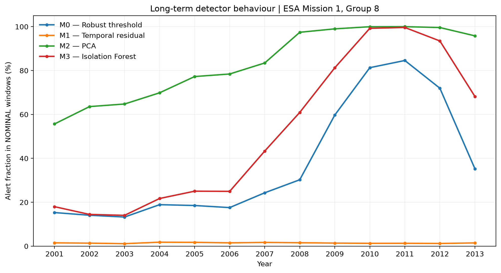
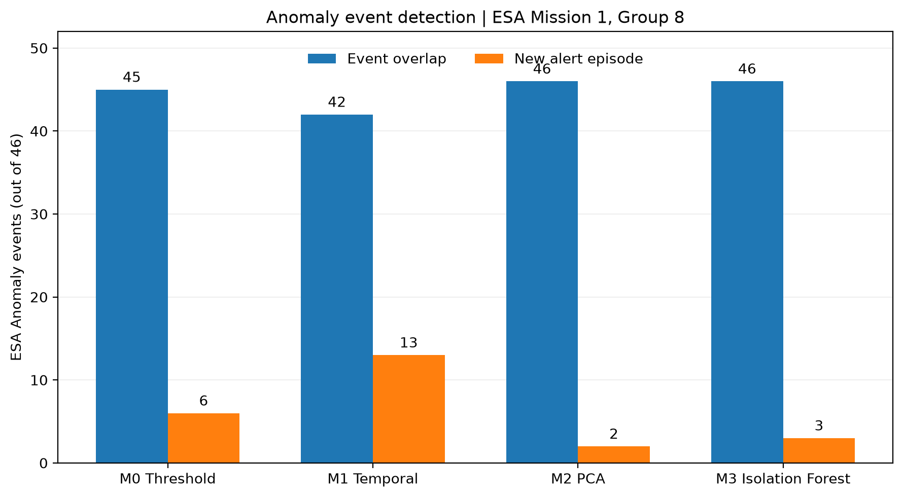

# M3 — Isolation Forest

## Objective

Evaluate whether a nonlinear, unsupervised anomaly detector improves
long-term spacecraft health monitoring compared with M0, M1 and M2.

## Method

- Dataset: ESA Mission 1, Group 8, six telemetry channels.
- Training: NOMINAL windows before 1 June 2000.
- Training samples: 445,722.
- Model: Isolation Forest, 100 trees, max_samples=256.
- Preprocessing: robust median/MAD scaling fitted on training data.
- Validation: NOMINAL windows from June through August 2000.
- Threshold: 99th percentile of validation window scores.
- Frozen threshold: 0.603551727.
- Evaluation: 2001–2013 without retraining.

## Results

Across 108 ESA events:
- Alert overlap: 101/108.
- New alert episode: 33/108.

For 46 ESA Anomaly events:
- Alert overlap: 46/46.
- New alert episode: 3/46.

The NOMINAL alert fraction increased substantially over time,
reaching 99.25% in 2010 and 99.63% in 2011.

These results indicate that high event overlap does not necessarily
correspond to informative new anomaly alerts. They do not establish
the physical cause of the long-term changes.

## Figures

## Reproducibility

- `scripts/export_m3_model.py`
- `scripts/run_m3_year.py`
- `scripts/summarize_m3_events.py`
- `scripts/plot_m3_comparison.py`
- `scripts/plot_m3_events.py`

Generated models, annual scores and event metrics are stored outside
the Git repository under the configured experiment output directory.
