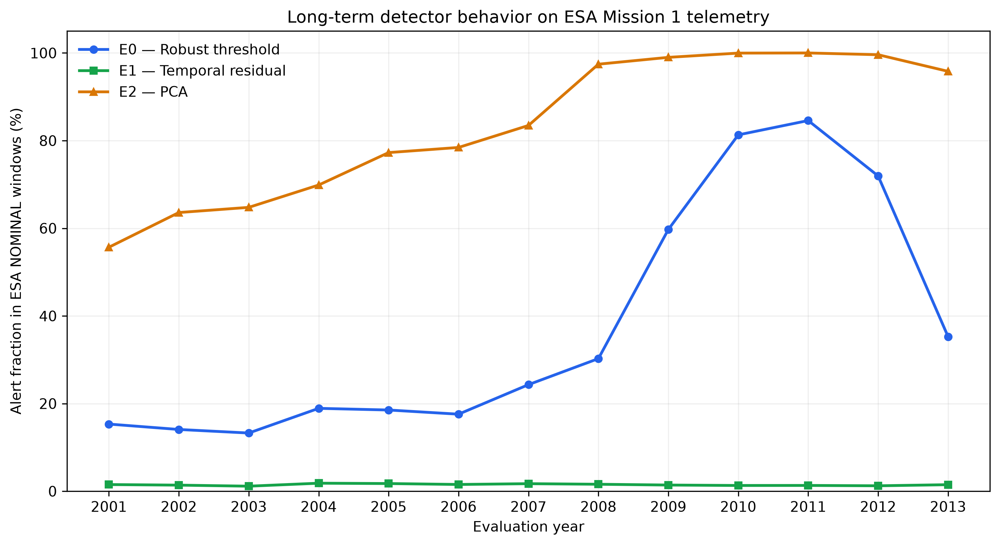
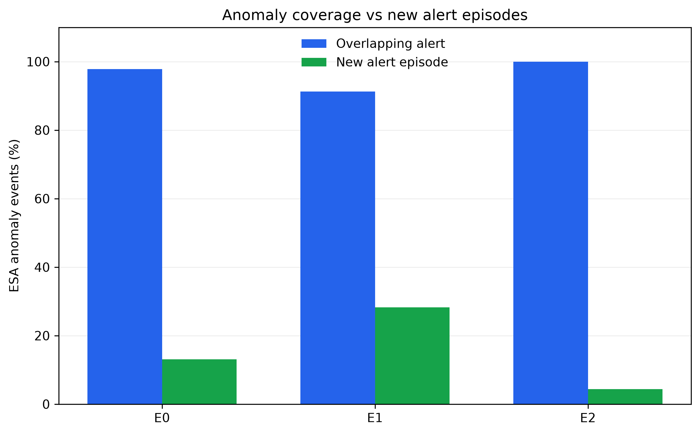

# Satellite Health AI
## Explainable Multivariate Anomaly Detection for Spacecraft Health Monitoring

**Technical Research Report — E4 Long-Term Temporal Evaluation**

### Abstract

This study investigates the long-term behavior of three interpretable anomaly detection methods applied to multivariate spacecraft telemetry from ESA Mission 1, Group 8.

Models and decision thresholds were established using data from 2000 and subsequently evaluated without retraining or recalibration over 2001–2013.

The methods comprise a robust statistical threshold detector (E0), a causal temporal residual detector (E1), and a Principal Component Analysis detector (E2).

The evaluation considers alert behavior in nominally labeled windows, overlap with ESA-annotated events, initiation of new alert episodes, and detection latency.

Results reveal substantial differences in temporal stability. E1 maintains a comparatively stable nominal alert fraction, whereas E0 exhibits a pronounced increase in later years and E2 approaches persistent alert saturation.

The study demonstrates why high overlap with annotated events is insufficient, on its own, to establish operationally useful anomaly detection.

---

## 1. Research objective

Spacecraft health monitoring requires detecting unusual telemetry behavior while maintaining interpretable and manageable alert activity.

Anomaly detectors calibrated on historical data may behave differently when applied to later operating periods. This creates an important evaluation challenge: a detector may continue to produce high anomaly scores without reliably distinguishing newly occurring events.

The central research question is:

**How do interpretable multivariate anomaly detectors generalize over long periods when their models and thresholds remain fixed?**

Three related questions are examined:

1. How stable is each detector's alert behavior across subsequent years?
2. Does overlap between alerts and reference events represent newly triggered detection?
3. What are the limitations of evaluating spacecraft anomaly detection using event annotations and nominally labeled telemetry?

The study emphasizes methodological transparency and critical evaluation rather than optimization of a single detection metric.

## 2. Dataset and scope

The experiments use ESA Mission 1 telemetry and associated event annotations.

The selected subset is Group 8, comprising six telemetry channels:

- `channel_41`
- `channel_42`
- `channel_43`
- `channel_44`
- `channel_45`
- `channel_46`

Telemetry is analyzed using 30-minute windows.

The experimental timeline is divided into an initial model-development period in 2000 and a long-term evaluation period covering 2001–2013.

The reference annotations distinguish NOMINAL windows and events categorized as Anomaly, Rare Event, or Communication Gap.

Across the 2001–2013 evaluation period, the event-level analysis includes 108 unique ESA event identifiers:

| ESA event category | Events |
|---|---:|
| Anomaly | 46 |
| Rare Event | 58 |
| Communication Gap | 4 |
| **Total** | **108** |

Event identifiers are evaluated as unique events rather than counted repeatedly for each affected telemetry channel.

The analysis is restricted to this particular mission and channel group. Results should not be assumed to generalize automatically to other spacecraft, telemetry subsystems, or operational contexts.

## 3. Methods

Three detectors are compared using a consistent evaluation framework.

### 3.1 E0 — Robust statistical threshold detector

E0 models nominal channel behavior using robust location and scale statistics based on the median and median absolute deviation (MAD).

Deviations from the nominal reference are evaluated across the selected channels.

A 30-minute window receives the maximum robust deviation score observed within that window.

This approach provides an interpretable statistical baseline but may be sensitive to long-term changes in channel operating levels or variability.

### 3.2 E1 — Causal temporal residual detector

E1 measures deviations from a rolling temporal baseline.

The baseline uses a 30-minute rolling median and excludes the current observation through a strictly causal window definition.

A minimum of 10 preceding observations is required for a valid rolling estimate.

Residual deviations are evaluated using robust scaling, and the window-level score is the maximum residual anomaly score within each 30-minute window.

The causal design avoids incorporating future observations into the local baseline.

Because sufficient preceding observations are required, some windows cannot receive a valid E1 score.

### 3.3 E2 — Principal Component Analysis detector

E2 applies Principal Component Analysis to the multivariate telemetry.

The fitted model retains two principal components.

Anomaly scores are based on squared prediction error (SPE), measuring residual variation outside the retained PCA subspace.

The maximum SPE score within a 30-minute window is used for alert evaluation.

PCA provides a compact representation of multivariate structure, but a fixed model can become poorly aligned with telemetry behavior observed in later periods.

An increase in reconstruction error alone does not establish the physical cause of the change.

## 4. Experimental protocol

### 4.1 Training and calibration

The detectors were fitted using nominal training observations from the initial period of 2000, before June 1.

The nominal training dataset comprises 7,079 windows and 445,722 telemetry samples.

Thresholds were calibrated on a separate validation period spanning June–August 2000, using the 99th percentile of the respective validation score distributions.

The resulting frozen thresholds were:

| Detector | Threshold |
|---|---:|
| E0 | 2.408636332 |
| E1 | 2.173326984 |
| E2 | 2.331041565 |

The fitted detectors and their thresholds were preserved as model artifacts.

### 4.2 Long-term evaluation

The frozen models were evaluated over 2001–2013.

No retraining or threshold recalibration was performed on these evaluation years.

For each annual dataset, detector scores were aggregated into 30-minute windows and compared against the corresponding frozen thresholds.

The annual comparison tables include window timestamps, reference labels, scores, and alert decisions for E0, E1, and E2.

### 4.3 Unscorable windows

Some telemetry windows cannot be scored because they contain no usable samples or insufficient preceding observations.

Across the 13-year evaluation:

| Detector | Unscorable windows |
|---|---:|
| E0 | 11 |
| E1 | 35 |
| E2 | 11 |

Missing scores are distinguished from negative alert decisions in the evaluation logic.

The nominal alert fraction is calculated using scorable NOMINAL windows as its denominator.

This distinction prevents missing observations from being treated automatically as evidence of nominal detector behavior.

## 5. Evaluation framework

### 5.1 Long-term nominal alert fraction

For each detector and year, the analysis calculates the fraction of scorable NOMINAL windows whose scores exceed the frozen threshold.

This quantity measures alert activity in windows labeled NOMINAL by the available annotation procedure.

It is not treated as a definitive false-positive rate because the annotations do not prove that every NOMINAL window is free of anomalous behavior.

### 5.2 Event overlap

An ESA event satisfies the alert-overlap criterion when at least one alert overlaps its annotated time interval.

This is a permissive criterion.

In particular, an alert episode that started before the event may remain active during the event and therefore count as overlap.

### 5.3 New alert episodes

A second criterion requires an alert episode to begin during the annotated event interval.

This separates persistent alert activity from newly initiated detector responses.

However, temporal coincidence does not establish that the annotated event caused the alert.

### 5.4 Detection latency

For events with newly initiated alert episodes, latency is calculated from the ESA event start to the end of the first qualifying 30-minute alert window.

Latency is therefore based on window closure rather than an assumed instantaneous detection time.

The reported latency statistics are conditional on an event having a new alert episode.

## 6. Results

### 6.1 Long-term alert behavior

*Figure 1. Annual fraction of scorable NOMINAL windows producing alerts, 2001–2013.*

The three detectors show substantially different temporal behavior.

E0 exhibits a marked increase in nominal alert activity during later evaluation years, reaching approximately 85% in 2011 before declining.

E1 remains comparatively stable, with annual nominal alert fractions generally between approximately 1% and 2%.

E2 shows a strong increase over time, approaching or reaching 100% nominal alert activity in several later years.

These observations are consistent with differing sensitivity to long-term telemetry changes, but they do not identify the underlying physical mechanisms.

### 6.2 Event-level detection

Across all 108 annotated ESA events:

| Detector | Events with alert overlap | Events with new alert episode |
|---|---:|---:|
| E0 | 95 | 34 |
| E1 | 80 | 36 |
| E2 | 106 | 28 |

For the 46 events classified specifically as ESA Anomaly:

| Detector | Alert overlap | New alert episode |
|---|---:|---:|
| E0 | 45/46 (97.8%) | 6/46 (13.0%) |
| E1 | 42/46 (91.3%) | 13/46 (28.3%) |
| E2 | 46/46 (100.0%) | 2/46 (4.3%) |

*Figure 2. Comparison of alert overlap and new alert episode criteria across 46 ESA Anomaly events.*

E2 overlaps all 46 ESA Anomaly events, but only two coincide with the beginning of a new alert episode.

This result must be interpreted alongside its high nominal alert fraction in later years.

E1 has fewer overlapping events than E2 but more ESA Anomaly events associated with new alert episodes.

E0 lies between these patterns in some respects, although the comparisons depend on the metric considered.

No single detector dominates across all evaluation criteria.

### 6.3 Latency of newly initiated episodes

For ESA Anomaly events with new alert episodes:

| Detector | Qualifying events | Median latency | Mean latency |
|---|---:|---:|---:|
| E0 | 6 | 109.1 min | 322.3 min |
| E1 | 13 | 498.6 min | 1095.5 min |
| E2 | 2 | 718.3 min | 718.3 min |

The number and identity of qualifying events differ across detectors.

Consequently, these statistics should not be interpreted as a controlled comparison of response speed on an identical event set.

In particular, E2's latency estimate is based on only two qualifying events.

## 7. Discussion

### 7.1 Event overlap and operational usefulness

The most consequential finding is the distinction between event overlap and newly initiated alert episodes.

A detector operating in a persistent alert state can overlap many reference events while providing little information about their onset.

This is particularly relevant to E2, whose high event-overlap count accompanies pronounced alert saturation during the long-term evaluation.

Thus, event-overlap performance alone can give an incomplete picture of practical detector behavior.

### 7.2 Temporal stability and detector design

E1's comparatively stable nominal alert fraction suggests that its local temporal baseline is less sensitive to some forms of long-term change than the fixed-reference approaches in this experiment.

However, this stability should not be interpreted automatically as better detection of all scientifically or operationally relevant anomalies.

A locally adaptive detector may respond differently to persistent shifts and transient deviations.

E0 and E2 provide complementary perspectives based on robust reference deviations and multivariate reconstruction error.

The observed differences demonstrate the importance of matching detector behavior to the intended monitoring objective.

### 7.3 Interpretability

The compared methods are sufficiently transparent to support diagnostic reasoning about their alert behavior.

E0 relates alerts to robust deviations from channel references.

E1 relates alerts to deviations from recent temporal behavior.

E2 relates alerts to residual structure outside a learned PCA subspace.

This interpretability supports investigation of model behavior but does not independently establish the physical meaning of an alert.

### 7.4 Scientific and operational trade-offs

The results illustrate several competing objectives:

- Detecting reference-event intervals.
- Producing newly initiated alerts rather than persistent alert states.
- Maintaining manageable alert activity over time.
- Preserving score availability and accounting for missing observations.
- Supporting interpretation of detector behavior.

These objectives cannot be reduced to a single event-overlap percentage.

## 8. Limitations

Several limitations constrain the conclusions.

**Dataset scope.** The experiments cover only one ESA mission subset and six telemetry channels.

**Annotation uncertainty.** ESA labels provide a useful reference but do not constitute exhaustive ground truth for every anomalous or nominal condition.

**Event attribution.** An alert episode starting during an ESA event does not prove that the event caused the detector response.

**Temporal dependence.** Consecutive alert windows and event episodes are not independent observations.

**Fixed thresholds.** The evaluation deliberately uses frozen thresholds. It does not establish whether retraining or recalibration would improve operational performance.

**Physical interpretation.** Alert increases and PCA reconstruction changes are observed statistical phenomena; the analysis does not establish their spacecraft-level causes.

**Latency comparison.** Latency is available only for the subset of events associated with new episodes, and those subsets differ across detectors.

**External validity.** Results cannot be generalized automatically to other missions, telemetry systems, or operational requirements.

## 9. Conclusions

This study evaluates three interpretable anomaly detection approaches under a frozen-model, long-term spacecraft telemetry monitoring scenario.

The main findings are:

1. Detector alert behavior can change substantially across years even when the model and threshold remain unchanged.
2. The causal temporal residual approach maintains a comparatively stable nominal alert fraction in this dataset.
3. PCA-based event overlap can appear strong while the detector spends much of its time in an alert state.
4. Separating alert overlap from new alert episode initiation provides a more informative description of event-level behavior.
5. Meaningful anomaly detection evaluation requires attention to temporal stability, score coverage, reference-label limitations, and operational interpretation.

The work demonstrates the importance of rigorous experimental design and critical evaluation when translating interpretable machine learning methods into long-term monitoring applications.

## 10. Future work

Potential extensions include:

- Evaluation on additional spacecraft telemetry groups or missions.
- Explicit analysis of operating regimes and distribution shift.
- Controlled comparison with adaptive model recalibration.
- Event-matched latency and alert-burden analysis.
- Investigation of channel-level contributions to persistent alerts.
- Evaluation of additional anomaly detection methods under the same frozen-model protocol.

These extensions are proposed research directions, not completed experiments.

---

**Project:** Satellite Health AI
**Focus:** Applied AI, interpretable anomaly detection, temporal generalization, and scientific R&D methodology.
